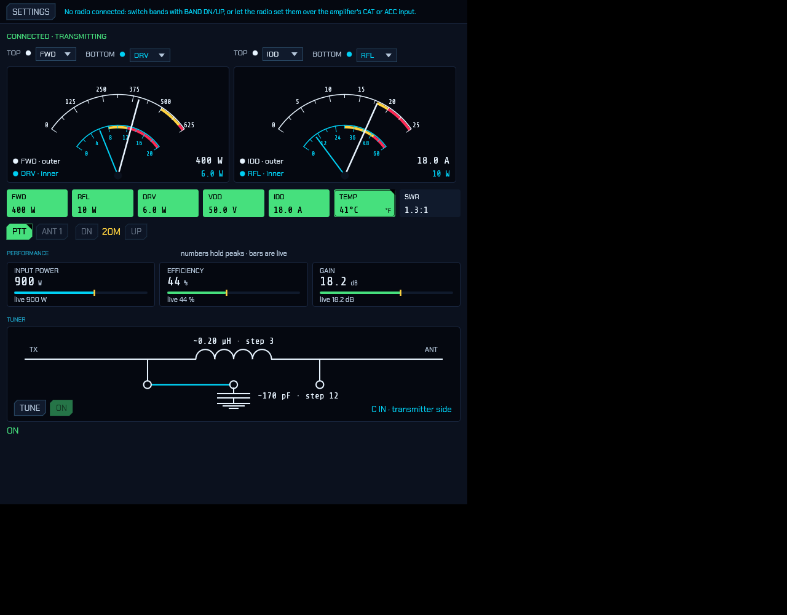

# Hardrock Panel

A standalone control panel for the **HobbyPCB Hardrock-500** linear amplifier
and its **ATU-500** tuner, on the amplifier's USB serial port.



It is the AMP window from [SDRoxide](https://github.com/dividebysandwich/sdroxide),
running on its own with no radio program beside it. It does the following:

- Shows the amplifier's readings live: FWD, RFL, DRV, VDD, IDD, TEMP and SWR,
  in the amplifier's own colours.
- Draws two cross-needle meters, with the needles chosen by the operator.
- Works out input power, efficiency and gain while transmitting, with a short
  peak hold for FT8 and SSB.
- Has controls for PTT / OFF, antenna and band DN / UP.
- Runs the ATU-500 tuner: TUNE and ON / BYP, plus a drawing of its network with
  estimated L and C values.
- Refuses to switch a relay while there may be RF in the amplifier. See
  [safety interlocks](docs/safety-interlocks.md).

The amplifier is still keyed by the radio's PTT line; the panel never keys it.

> Tested with a Hardrock-500 and ATU-500 on Windows 11 only. The Hardrock-50
> can be chosen and is marked *untested*.

## Download

Windows: download `hardrock-panel-windows.zip` from Releases, unzip it, and run
`hardrock-panel.exe`. Nothing needs to be installed.

## Using it

See the [user guide](docs/user-guide.md). In short:

1. Close HobbyPCB's control panel, and any other program using the amplifier's
   port. Only one program can hold the port.
2. Start the panel. In **Settings**, tick **Enable**, choose the port (COM5,
   for example), leave the baud at 115200, and press **APPLY**.
3. Switch bands with **DN** and **UP**, or let the radio set them over the
   amplifier's own CAT or ACC input. With no radio program beside it, the panel
   never changes the band on its own.

`hardrock-panel.exe --port COM5` opens straight onto the amplifier on COM5.

## Building

You need Rust 1.85 or later.

```
cargo build --release
cargo test
```

Cross-compiling for Windows from Linux:

```
rustup target add x86_64-pc-windows-gnu    # needs mingw-w64
cargo build --release --target x86_64-pc-windows-gnu
```

### Trying it without an amplifier

On Linux or macOS, `tools/fake_hr500.py` pretends to be a Hardrock-500 with an
ATU-500 on a pseudo-terminal:

```
python3 tools/fake_hr500.py            # prints the port, e.g. /dev/pts/3
python3 tools/fake_hr500.py --keyed    # transmitting at about 400 W
cargo run -p hardrock-panel -- --port /dev/pts/3
```

`cargo run -p hardrock --example hrctl -- /dev/pts/3` talks to it from the
command line.

## Layout

| Path | What it holds |
|---|---|
| `crates/hardrock` | The amplifier's serial protocol and the background link that polls it and holds the interlocks |
| `crates/hardrock-panel` | The window: panel, meters, settings and SDRoxide's look |
| `docs/` | User guide, [safety interlocks](docs/safety-interlocks.md), [design decisions](docs/design-decisions.md), [ATU values](docs/atu-values.md), [open items](docs/todo.md) |
| `docs/history/` | The SDRoxide build's notes, test log and bench measurements |
| `tools/` | The simulated amplifier |

## Rules this code keeps

These carry over from the SDRoxide build. Each is explained in the docs.

- Every block that refuses an action for safety is marked `SAFETY INTERLOCK`
  in the code and listed in [safety-interlocks.md](docs/safety-interlocks.md).
- Raw readings are live. Only derived figures (input power, efficiency, gain)
  hold a peak.
- Yellow and red mean a warning. A neutral state is blue.
- Every scale shows its yellow and red stretches.
- Anything that can be clicked shows a pointing hand and an outline.
- Anything that departs from the original design is written up in
  [design-decisions.md](docs/design-decisions.md).

## Credits and licence

Hardrock Panel is derived from SDRoxide by dividebysandwich and its
contributors, and like SDRoxide is licensed under the
[GNU GPL, version 3 or later](LICENSE). The fonts Chakra Petch and Share Tech
Mono are under the SIL Open Font License; see `crates/hardrock-panel/assets/fonts/`.

Hardrock-500, Hardrock-50 and ATU-500 are products of HobbyPCB. This project is
not affiliated with HobbyPCB. No HobbyPCB manuals, schematics or firmware are
included.

Maintained by AJ3G.
