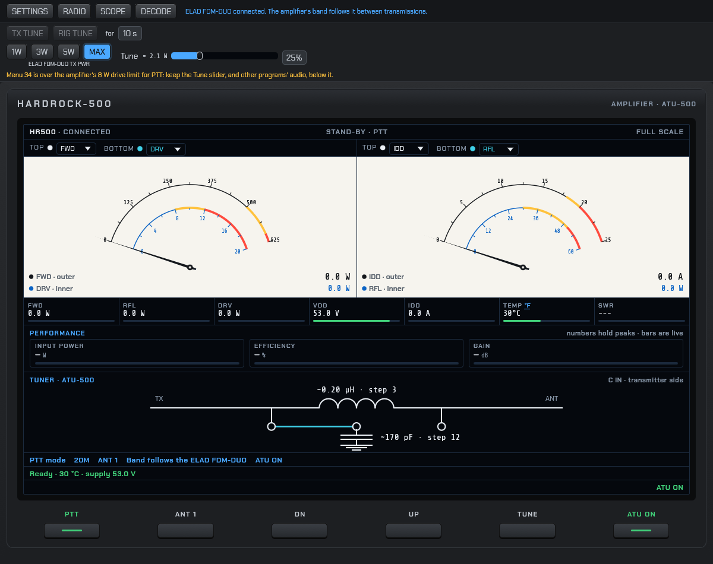
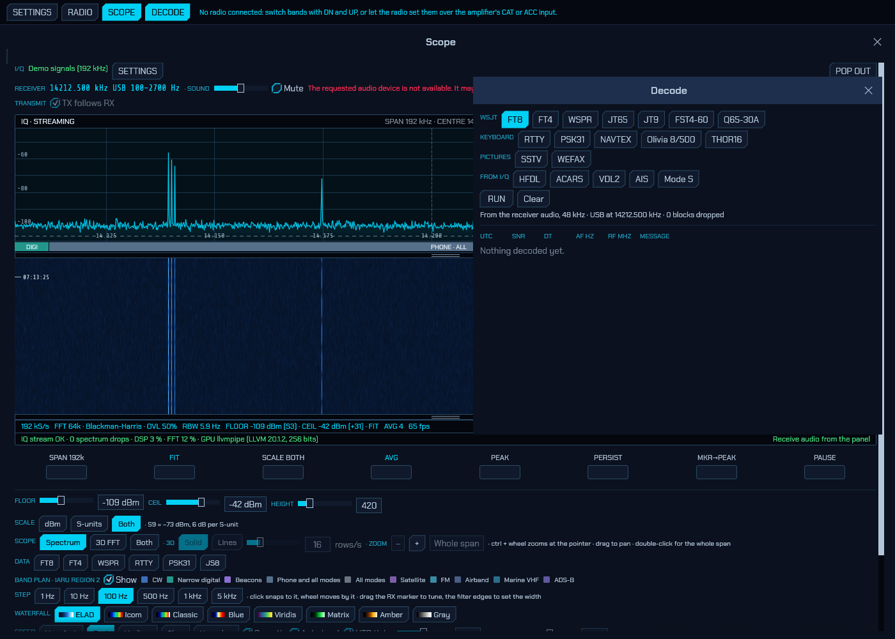
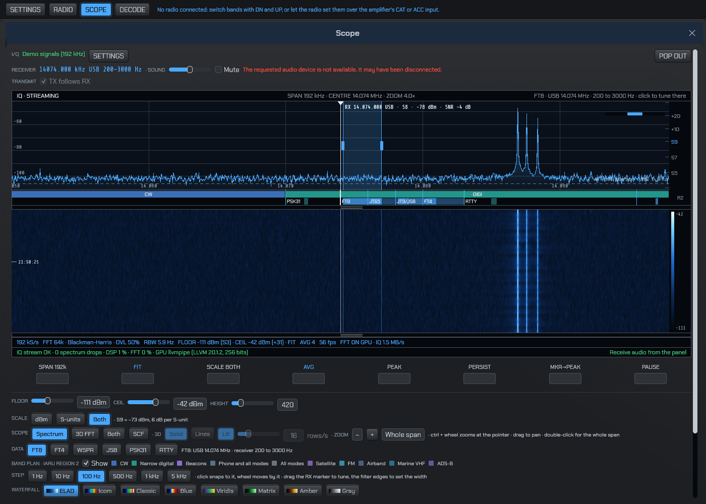
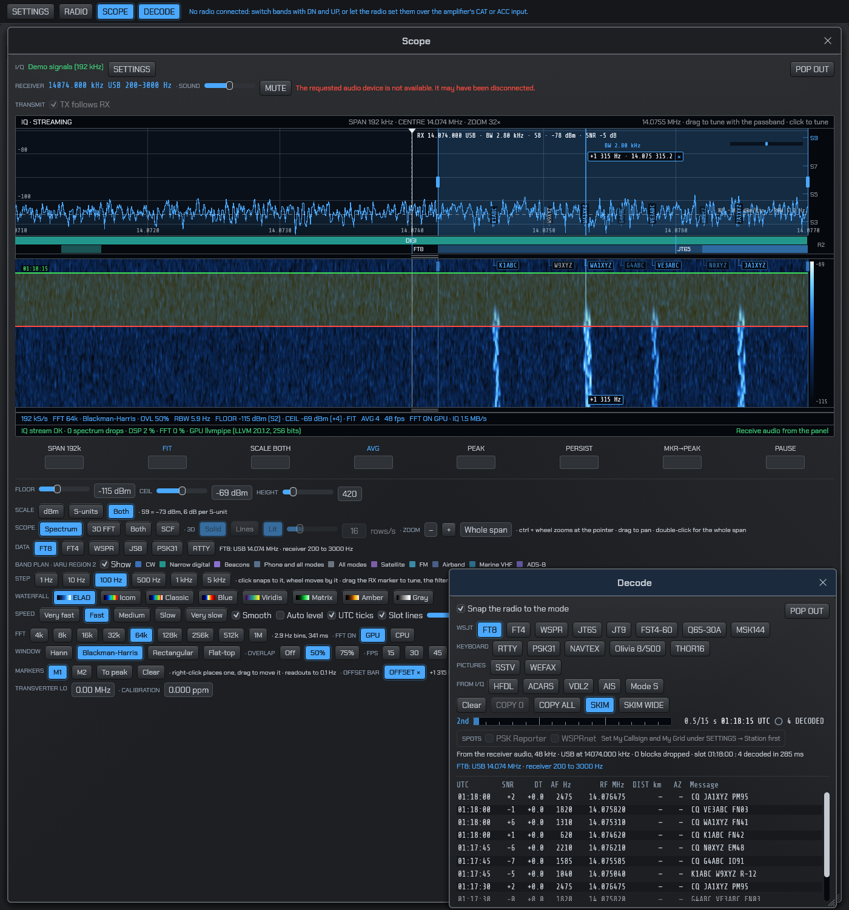

# Hardrock Panel user guide

Hardrock Panel watches and controls a **HobbyPCB Hardrock-500** linear
amplifier over its USB serial port. It shows the amplifier's meters and
readings, works out input power, efficiency and gain while you transmit, and
runs its ATU-500 tuner. The amplifier is still keyed by the radio's PTT line,
as before; the panel never keys it.

It is the AMP window from SDRoxide, running on its own. It needs no radio
program. It can also read an ELAD FDM-DUO's own power, SWR, dial and settings
over the radio's CAT port, set its power, and key its TUNE carrier (see
[The radio](#the-radio)).

> **Tested only with the Hardrock-500.** The Hardrock-50 can be chosen and is
> marked *untested*: it shares the command set, but its limits are scaled
> from the Hardrock-500's and its built-in tuner is shown as raw steps. Watch
> the amplifier's own display until it has been tried on a real one.
>
> Tested on Windows 11 only.

**The ELAD look.** With the ELAD FDM-DUO chosen as the radio under SETTINGS,
the whole panel (the top bar, the TUNE strip, SETTINGS, SCOPE, DECODE and
every key, field and menu) wears ELAD's graphite and blue, to match the
radio's face and the DUO-ART screen of the AMP window. With no radio, or
another, it keeps SDRoxide's look. `--theme elad` or `--theme sdroxide` on
the command line forces either; `--demo` shows the ELAD look.

## Setting it up

1. Plug the amplifier's USB lead in and turn the amplifier on.
2. Start `hardrock-panel.exe`. On the first run the **Settings** window opens
   by itself; later, open it with **SETTINGS** at the top left.
3. Tick **Enable**, then choose the **Model** and the **Port** the amplifier
   appears as (COM5, for example). If the port isn't listed, press
   **REFRESH DEVICES**.
4. **Baud** must match the amplifier's menu. HobbyPCB's own control panel
   needs 115200, so an amplifier that has been used with it is already there.
5. Press **APPLY**. The status line reads *Connected to the Hardrock-500* when
   the amplifier answers.

**Only one program can have the port open.** Close HobbyPCB's control panel,
and turn off SDRoxide's own amplifier link, before connecting here. If the port
is busy the status line says it is in use by another program, and the panel
connects by itself as soon as that program lets it go: there is no need to
unplug anything.

**SWR warning at** sets where the SWR tile turns red and the meters warn that
FWD and RFL can't be trusted. It starts at 5.0:1, where SDRoxide warns with its
default settings.

The settings, the meter picks, and the window's size and place are kept between
runs.

**The log.** The panel writes what it does, and any fault, to
`hardrock-panel.log` in the same folder as its settings: on Windows
`%APPDATA%\Hardrock Panel\data`. It is kept to a few MB. Where a message says
to see the log, COPY LOG beside it copies the end of it for a bug report.

**From a shortcut.** `hardrock-panel.exe --port COM5` opens straight onto the
amplifier on COM5, ahead of the saved settings. Add `--baud 38400` for another
baud rate. `--radio COM3` (and `--radio-baud 57600`) does the same for the
radio. `--demo` opens the scope on the demo band, `--elad` on the ELAD's I/Q,
`--decode` opens DECODE, and `--size 1200x900` sets the window's size.

## The radio

The panel can read an **ELAD FDM-DUO** over its CAT port, the one SDRoxide or a
logger would use. Besides reading, it changes only the radio's power setting
(menu 34) when you press a power button and its TX IN (menu 32) when you press
USB AUDIO, and keys the radio only when you press TX TUNE or RIG TUNE.

1. In **Settings**, under **Radio**, tick **Enable**, choose the **Port** the
   radio's CAT appears as (COM3, for example), and the **Baud**. It must match
   the radio's menu 70 `CAT BAUD`; the DUO ships at 38400. The port is always
   8N1.
2. Press **APPLY**. The line along the top reads *ELAD FDM-DUO connected*.

As with the amplifier, only one program can have the radio's CAT port open:
close SDRoxide, FDM-SW2 or a logger that uses it first.

**What it gives the panel.** In OFF (bypass), the amplifier reports no FWD,
RFL or SWR. With the radio connected these are the radio's own: its forward
and reflected power (`FP`, `RP`) and its SWR (`WR`), shown while it
transmits. The legends say *from the rig*. Below 0.5 W, in receive, and when
it folds back into a bad load, the DUO flags its readings as not to be
trusted; the panel then shows FWD and RFL as flagged rather than borrowing the
amplifier's DRV, which over-reads into a mismatch. In PTT the amplifier's own
readings are used, and DRV, input power, efficiency and gain are always the
amplifier's.

**The radio window.** **RADIO** along the top opens the radio's own face: its
LCD, with the dial, the annunciators (LP, ATT, ANT, IN, CAT, SPLIT, RIT, the
VFO, XVTR, RX and TX), the S-meter (forward power while transmitting) and the
power setting, RIT offset and level or SWR. The S-meter reads the station
you listen to: the DUO's own meter when the panel's receiver is on VFO A at
SPAN 192k, and the panel's receiver's level (calibrated with the DUO's own
figures) when it listens anywhere else, at a wider SPAN or in split, since
the DUO's own receiver then sits on VFO A, the middle of the span. Click the top half of a digit to
step it up and the bottom half to step it down, or scroll over it; carries
roll into the next digit, and the dial stays inside the radio's 9 kHz to
54 MHz. With the pointer on the dial the arrow keys pick and step a digit, and
typing a number opens **F INPUT**: MHz below 100 (14.074), kHz from 100 up
(7074), or with a unit. LP, ATT, ANT and IN on the LCD are keys too; IN asks
before it changes where the radio takes transmit audio from.

Under the LCD, **MODE** sets the mode, or a data mode (FT8, FT4, WSPR, RTTY,
PSK31, JS8): USB, its frequency on the band, a filter for its passband and, if
you say yes when asked, TX IN on USB audio. **BAND** goes back to the last
frequency and mode used on each band. **RX**, **CW**, **TX AUDIO** and **MEM**
open the radio's receiver and audio, the keyer with its ten stored messages,
the transmit audio, and memory recall. **MENU** lists every setting the radio
has a CAT command for, grouped, with the ones that can't be changed shown as
read only, and the panel's own display settings: the LCD backlight in receive
and in transmit, and a transverter offset.

**The knobs.** The silver knobs beside the LCD work as the radio's own. Scroll
over one, or drag round it, to turn it, click it for the
radio's push, and hold it down for the radio's push and hold (menu 71 HOLD
TIME, 1 s as shipped). The line under each says what it does now, and hovering
says more.

- **Main knob.** Turning tunes the receive VFO by the step shown under it, or
  in MEM picks the next or previous memory channel. A click opens STEP: turn
  to choose the step (1 Hz to 1 MHz, the dial's digits), click again to go
  back. A hold starts digit by digit: turn to change the lit digit, use E1 or
  E2 to move along, and click or hold to go back.
- **E1.** Turning changes VOL, SQL, AGC (AGC or manual gain), NR or NB, the
  one named under it; a click picks the next. NR and NB here are the DUO's
  own, on the DUO's audio: heard at SPAN 192k, not above it (use SCOPE's NR
  there). VOL is one volume with
  RADIO's VOLUME and SCOPE's Sound slider: move any of them, or the radio's
  own knob, and the others follow, so it turns whichever audio you hear (the
  radio's at 192 kHz SPAN, the panel's receiver wider). That is only while
  the panel's sound goes to the ELAD's own USB audio. With another speaker
  picked (the Klipsch, say), E1's VOL turns the panel's Sound instead and
  the caption reads VOL n PC; the DUO's own speaker is muted (its volume set
  to 0) and set back as it was when you pick the ELAD's audio again. E1's NR
  also sets SCOPE's NR (DUO NR 1 to 10 maps to the panel's 1 to 4), so it
  acts on what you hear at any SPAN.
- **E2.** Turning changes the receive filter, the CW pitch (in CW) or the RIT
  offset (while RIT is on); a click picks the next.
- **Lock.** Holding E1 or E2 locks the knobs and the dial, as pressing both
  together does on the radio, and LOCKED shows. Hold either again to unlock.
  The lock is the panel's: the radio's own lock has no CAT command.

Everything shows what the radio reads back, not what was asked for, and greys
while the radio transmits. A stored CW message is sent only when RIG TUNE
could be keyed.

**Transverter.** Set the converter's local oscillator under MENU, Panel
display (116 MHz for a 2 m converter on 28 MHz, negative for one whose LO is
above). The LCD then shows the RF frequency with XVTR lit, F INPUT takes the
RF frequency and sends the radio the IF, and BAND offers the bands the
converter reaches. The radio is never told.

**TUNE.** With the radio connected, a strip under the top line has two ways to
key the radio, its power buttons, the **Tune** slider, and how long TUNE may
run (10 s to start, up to 60 s).

- **1W, 3W, 5W, MAX** set the radio's menu 34 `TX POWER`, as SDRoxide's
  buttons did. It stays set after the panel closes, as on the radio's menu, and
  is the ceiling for every program that transmits. Use MAX with the HR500 in
  line, and bring the power down with the slider.
- **Tune** sets TX TUNE's power within the button's setting: 50% of 5W is about
  2.5 W. The panel shows what it should come to; the meters show what it is.
  It can be moved while keyed.
- **TX TUNE** plays a 1 kHz tone into the radio's USB audio and keys the radio
  as its PTT does, which also keys the amplifier through the PTT line, as
  SDRoxide's TUNE did. It needs the radio's TX IN (menu 32) on USB audio (a
  yellow line with **USB AUDIO** appears if it isn't) and the radio in USB or
  LSB. The tone plays on **TUNE sound** under Settings, Radio: the radio's own
  USB audio unless you choose another.
- **RIG TUNE** keys the radio's own TUNE carrier at the full button setting,
  with no tone. The FDM-DUO may not key its PTT output for it, so the HR500 may
  stay in receive; use TX TUNE to watch the amplifier.

Press either again to unkey. They are greyed, with the reason on hover, unless
the amplifier is connected and, in PTT, on the radio's band,
with the power within its 8 W drive limit (so RIG TUNE at MAX, about 8.3 W,
only in OFF, and TX TUNE at MAX up to 96%). They unkey by themselves at the
time limit, on a trip, if the drive goes over the limit, if either SWR reaches
the SWR warning in Settings, if the radio drops to receive on a high SWR, and
if the panel closes or stops responding. The reason is shown after it stops.
These are safety interlocks #5, #6 and #7.

**Clearing a trip.** A trip stops TUNE at once. The HR500 keeps showing the
trip until it is keyed again and sees normal readings; it has no reset
(its manual: trip conditions "do not need to be manually reset, all
conditions are set to normal the next time the amplifier is keyed"). So once
the cause is fixed (the right antenna picked, say), TUNE keys again to clear
it, at no more than the 8 W drive limit, in PTT or OFF. That TUNE is not
stopped by the trip it was started to clear, but a new trip stops it, as do
all the other stop conditions. Stored CW messages and outside programs stay
refused until the trip has cleared.

**When the amplifier doesn't key.** If the radio transmits for more than a
moment with the amplifier in PTT and the amplifier's own TX light stays off,
the top line says so in yellow. The HR500 keys only from its PTT input (the RCA
jack, or pin 4 of ACC); check the cable from the radio and the radio's PTT
output setting.

Not to be confused with the tuner's **TUNE**, which starts the ATU-500's
tuning cycle and needs a carrier: TX TUNE or RIG TUNE can provide one.

**RADIO** at the top left opens the radio's window: its dial, large, its live forward and
reflected power, SWR, TX POWER (menu 34) and TX IN (menu 32), the TUNE strip, then
every setting the radio answers over CAT, with its menu number, its meaning and the radio's
answer as it came. **POP OUT** moves it into a window of its own, and
**DOCK** brings it back. Popped out, it grows and shrinks with its window,
keeping its proportions; docked, drag its side to make it wider and it grows
the same way. The settings are read when the port opens, when you press
**READ AGAIN**, and every 10 seconds between transmissions. Menus that have no
CAT command, such as 37 `CW IN` and 45 keyer speed, can only be read on the
radio.

## Band switching

SETTINGS, Radio, **Amplifier band** says where the amplifier's band comes from:

- **From the radio's cable to the amplifier**: the FDM-DUO sets it over the
  interface cable between them, with the HR500's Transceiver menu on ELAD FDM
  DUO. The panel sends no band.
- **From this program, over the radio's CAT** (to start, as in SDRoxide): the
  panel reads the radio's dial over its USB CAT port and sends it to the
  amplifier when the band changes. Use it as a backup if the interface cable
  fails, with the HR500's menu set to **Transceiver: None**. It changes only
  between transmissions: while there is RF in the amplifier the change waits,
  and goes out once you unkey.

The line under the choice says which Transceiver menu setting it needs.

**A radio cabled to the amplifier.** If the radio is also wired to the
amplifier's ACC jack (the FDM-DUO's EXT IO, for example) and the HR500's
**Transceiver** menu names that radio, the amplifier takes its band from the
cable and puts back any other, whatever the panel's setting. The panel can't
change that menu: the amplifier has no command for it. If DN or UP doesn't
hold, the line along the top turns yellow and says so; **DISMISS** beside it
hides the note until a band press holds again. To control the band from the
panel, set the amplifier's menu to **Transceiver: None**, connect the radio
under SETTINGS and set **Amplifier band** to this program; it then does what
the cable did.

With no radio connected, nothing tells the panel the radio's frequency, so it
never changes the amplifier's band on its own. Switch bands with **DN** and
**UP**, or let the radio set the band over the amplifier's own CAT or ACC
input. The line along the top of the window says which applies.

## The window

**Its look.** With the FDM-DUO chosen under SETTINGS the window is drawn as
the screen of ELAD's DUO-ART 120 amplifier, to match the radio: the meters
as white dials, a blue status line (mode, band, antenna, where the band
comes from, the tuner), a green diagnostic line, a message line with any
warning on the left and the tuner's state on the right, and the controls as
six soft keys under the screen, each with its label above it. Everything
below is the same in either look; only the drawing changes. Without a
radio the window keeps its own look.

**Its own window.** **POP OUT**, at the top right of the amplifier's panel,
moves it into a window of its own, to put on another screen; **DOCK** there,
or in the main window while it is out, puts it back. **AMP** on the top bar
shows or hides it, as RADIO, SCOPE, DECODE and GLOBE do theirs; closing its
window hides it. Hidden, the warnings on the top bar still show.

**Where windows open.** Every window opens docked the first time. Popped out
and moved or resized, AMP, RADIO, SCOPE, DECODE and GLOBE each open there
again next time, at that size, and whether each is popped out is kept
between runs.

**What can be clicked.** Anything in the window that does something when
clicked shows a pointing hand and a white outline when the mouse is over it.
If the outline appears, it's a control; if it doesn't, it's only a display.
PTT / OFF and the TEMP tile, which would otherwise look like a light and a
reading, also carry a small folded corner at the top right. A button greyed
out by an interlock (see below) shows no outline, because clicking it does
nothing.

**Meters.** Two cross-needle meters, each with a white outer needle and a blue
inner one. Choose what each needle shows with its **TOP** and **BOTTOM**
pickers: forward power, reflected power, drive, supply volts or drain current.
They start as FWD over DRV on the left, so the power meter shows the radio's
drive going in beside the amp's output, and IDD over RFL on the right.
Picking a reading already on the other needle swaps them. The needles are
live; they don't hold peaks. Every scale shows its yellow and red stretches,
and readings that run past the end are marked beyond the arc with their
values, so the limits are always in view.

**When a scale changes range.** The meters start on their full scales: until
power is first seen, the amplifier is taken to be in line and ready to make
full power. Only these change a scale's range, and the legend always says so:

| When | What changes | Legend | Back |
|---|---|---|---|
| The power stays at 10 W or less for 2.5 s while transmitting, in line or in bypass | FWD and DRV to 0–10 W, RFL to 0–2 W | *10 W scale* | To full scale at once when the amp is in line and the power goes over 10 W |
| In OFF (bypass), the power goes over 10 W for 2 s in all, or swings over it twice | FWD and DRV to 0–100 W, RFL to 0–20 W: a 100 W radio running through the bypassed amp | *100 W scale* | Down to the 10 W scale once the power settles at 10 W or less for 2.5 s |
| The power goes over 100 W, or over 10 W with the amp in line | FWD, DRV and RFL to their full scales | (none) | (this is the start) |
| Two needles on one meter would sit on top of each other | The inner (bottom) scale only, to ½, ⅕ or 2× its range, whichever parts them, so both can be read | *rescaled* | Once the needles are well apart on the usual scale |

In OFF (bypass) the radio's own power passes straight through the amp, so the
power counted is the higher of FWD and DRV. Going up to the full scales never
waits, so a needle is never held pinned at real power; coming down waits for
the power to settle. A power range and a rescale can apply at once (*10 W
scale, rescaled*).

**Running barefoot in bypass.** In OFF the DRV tile stays green whatever it
reads, tuner in or not, because the radio's power passing straight through is
not a fault. **PTT** is greyed while the drive is over the amplifier's drive
limit (8 W on the HR500): hover over it to see why, and lower the radio's
power before putting the amplifier in line.

In OFF the amplifier reports no forward or reflected power and no SWR. With
the radio connected they are the radio's own (see [The radio](#the-radio)).
With no radio to ask, **FWD** shows the amplifier's DRV reading, which measures the
radio's power at the amplifier's input; in bypass that power goes straight
through. The legend says *from DRV*. DRV over-reads into a mismatch, so treat
it as a guide. RFL and SWR stay empty in bypass. In PTT the amplifier's own
readings are always used.

**Readings.** Seven tiles: FWD, RFL, DRV, VDD, IDD, TEMP and SWR. Each takes
the amplifier's own colour for that reading: green, yellow or red. A colour
the amplifier holds after a transmission (it latches red until the next
key-up) is held here too, with one exception. Until your first transmission
after the panel connects, a yellow from the amplifier shows green. The HR500
can start up with DRV yellow, or still hold a yellow from an earlier session,
with nothing wrong now. A red (a trip) always shows. From your first key-up the
tiles follow the amplifier's lights exactly, so its own screen and this one can
differ only before then. SWR has no colour of its own, as on the amplifier,
except that it turns **red** at or past the SWR warning set in Settings. Click
**TEMP** to switch between °C and °F; it switches the amplifier's own display
as well.

**Controls.**

- **PTT / OFF** puts the amplifier in line (green) or in bypass (blue).
- **ANT** chooses the antenna jack.
- **DN / UP** step the band.

**Performance.** Input power (volts × amps), efficiency (output over input) and
gain (output over drive, in dB), worked out only while transmitting. The
number holds its peak for a second and then falls away; the bar under it is
live, with the held peak marked on it. This suits FT8 and SSB, where the
readings move too fast to read.

**Tuner.** A drawing of the ATU-500's network: the inductor and capacitor it
has switched in, with values, and which side the capacitor is on. When the
tuner is bypassed, the drawing shows the bypass relays instead.

- **TUNE** starts a tune. It blinks blue while tuning, turns green when tuned
  and red if the tune fails, with the result and SWR on the line below.
- **ON / BYP** puts the tuner in line or bypasses it.

The tuner only reports step numbers. The values shown (for example "~0.20 µH ·
step 3") are an estimate that includes the board's own stray inductance and
capacitance, judged good to about 10%. How the values were arrived at is in
[atu-values.md](atu-values.md).

**Resizing.** Drag the window to any size: the panel scales to fit its width
and height and sits centred in it. In a window much wider than it is tall, the
panel stops widening at a little over its own proportions and sits in the
middle.

**The buttons.** PTT (it reads PTT ON in green with the amplifier in line, PTT OFF in blue in bypass), ANT, DN/UP and ON/BYP change on the screen as soon
as they are clicked, in blue, and turn to their usual colour once the
amplifier reads back the change. One the amplifier refuses (a relay while
transmitting, or PTT with too much drive) goes back at once; one it still
shows unchanged after a second goes back to what it reads.

## The scope and the panel's receiver

**SCOPE**, on the top bar beside RADIO, opens the panadapter: the spectrum (or
the 3D FFT), the band plan and the waterfall from the radio's I/Q, with the
panel's own receiver in it. **POP OUT** puts it in a window of its own; **DOCK**
brings it back over the panel.

**The line under the scope** says how it is keeping up: *DSP %* is the share
of one CPU core the panel's receiver (filtering and demodulation) takes, and
moves with SPAN, not with the FFT's resolution. *FFT %* is the CPU spectrum's
share of a core; with the spectrum on the graphics card it reads *FFT on the
GPU* and the frames a second it draws instead, since the CPU then does no
FFT. *GPU %* is this program's share of the graphics card, everything it
draws there (FFT, waterfall, windows), read from Windows as Task Manager's GPU
column reads it: a finer FFT resolution or a faster waterfall raises it.

**Where the I/Q comes from** is chosen under SETTINGS, *Scope and receiver*,
with APPLY:

- **ELAD over USB**: the FDM-DUO's second USB lead (the I/Q device). On
  Windows that device must be on the **WinUSB** driver, set with Zadig; ELAD's
  own FDM-SW2 can't see it until its driver is put back. If it won't open, the
  scope's I/Q line says why in the driver's words, with **TRY AGAIN**. The
  panel waits a few seconds for the CAT link to read VFO A and opens the I/Q
  there, so opening doesn't move the radio. While it runs, **REOPEN** on the
  same line closes the I/Q and opens it again without closing the panel. If
  the stream stops, the panel opens it again by itself (never while
  transmitting) and keeps trying every 20 s until it is back; the yellow line
  under it says when. If it keeps failing, unplug the radio's I/Q USB lead
  and plug it back in.
- **Demo signals**: a made-up band to try the scope, DECODE and the
  skimmers with no radio. On whichever band you tune to there are made-up
  FT8, FT4, JT9 and JTTY stations on that band's dials (14.074, 14.080,
  14.078 and 14.090 on 20 m), and CW, PSK31 and RTTY stations near the
  band's foot and its PSK31 and RTTY dials. A few filler signals that follow
  the centre and carry nothing are labelled SSB FAKE, CW FAKE and CARRIER
  FAKE.

**Tuning.** As in SDR Console, the span stays centred on the DUO's VFO A
while the panel's receiver moves inside it. Click a signal to tune to it, drag
the receiver marker, drag a filter edge to set the width, wheel to step,
ctrl+wheel to zoom, drag to pan, double-click for the whole span. When the
receiver nears the edge, the panel moves VFO A (over CAT) and the span
follows. Turning the radio's own knob moves the span, and the receiver with
it. **SPAN** changes the I/Q rate (192 kHz to 6.144 MHz). On the DUO, 192 kHz
is the radio's own; for every wider rate the panel takes the radio out of
stand-alone by loading ELAD's wide image into it, as SDR Console does. That
takes about 7 s each time SPAN changes, and the I/Q line says so meanwhile.
The image is read from ELAD's driver, `ExtIOmc_ELAD_FDMDUO.dll`, which SDR
Console or FDM-SW2 installs, so one of them has to be installed. Not while
transmitting. While a wide image runs, the DUO shows SP and its band keys and
the panel's band changes don't move it. Back at SPAN 192k the panel has the DUO
reload its own image, as FDM-SW2 does, which takes about 4 s and puts it back
in stand-alone. If that fails, a yellow note says to power-cycle the DUO.

**Listening.** The receiver plays on the sound output chosen under SETTINGS,
*Receiver sound*: the computer's default output to start, or any other by
name, VB-Cable's *CABLE Input* included, to feed an outside decoder. The
scope has its volume and **Mute**. Up to 192 kHz the DUO plays its own audio
too, and the panel sets the DUO's mode and filter to the receiver's; above
192 kHz the DUO mutes its own audio and the panel's receiver is the one heard.
**NR**, beside MUTE, is the panel receiver's noise reduction: click for 1, 2,
3, 4 and back to off (right-click: off). It is an adaptive filter that keeps
what it can predict, a CW note or a voice, and drops the hiss: 1 or 2 for
SSB, 3 or 4 for CW. It works on what you hear only; the decoders get the
audio untouched. The DUO's own NR, on RADIO's E1 knob, works on the DUO's
audio, which is what you hear at 192 kHz SPAN; turning it also sets this NR.
The panel's receiver and its slices go quiet while the radio transmits, and
for 0.3 s after: the DUO keeps sending I/Q during an over, and it would be
heard as static.

**TX follows RX** (on to start) makes the radio transmit where you listen.

- *Why it's needed.* The scope's centre is the DUO's VFO A, and it stays put
  while you click stations inside the span: only the panel's receiver moves.
  The radio itself transmits on its transmit VFO, so without help it would
  transmit on VFO A, not where the receiver and the OFFSET marker are. With
  the receiver 4 kHz above the dial, that is 4 kHz below the marker.
- *What it does.* While the receiver is off VFO A, the panel puts VFO B on
  the receiver and turns split on, so the radio shows SP and its display
  reads VFO B, the receiver's frequency. When the receiver is back on VFO A,
  split comes off. VFO B and split are never changed while transmitting.
- *Band changes.* A band key on RADIO or the DUO, or its knob, moves VFO A.
  The scope follows VFO A as read over CAT, the receiver moves with it by
  the same amount, and VFO B and split follow the receiver once it settles.
  (In split, and at any SPAN above 192k, the DUO's own USB dial read-back
  doesn't say where VFO A is, so the panel uses CAT here, not the read-back.
  With no CAT link, a band change on the radio isn't seen in those cases.)
- *The offset bar is the transmit marker.* With the red bar up, the radio
  transmits on the bar instead of on the receiver, anywhere inside the span:
  - *SSB, CW, AM and FM:* VFO B moves as far as the bar is from where OFFSET
    drops it (the middle of the passband), with split on. A bar dropped there
    transmits on the receiver; drag it 2 kHz up and you transmit 2 kHz up
    while still listening on the receiver.
  - *Data modes (a DATA key lit):* VFO B stays on the receiver's dial and the
    bar's offset is the transmit audio offset, as WSJT-X's red goalpost is.
    Set that figure as the TX offset in your data program. Past the mode's
    audio range (FT8: 200 to 3000 Hz), VFO B moves instead so the middle of
    the range lands on the bar, and the readout gives that audio figure.
  - The Markers row says where you will transmit (*TX on the bar: VFO B
    14.076 600.0*, *TX audio +1 234 Hz*), and the bar's flag starts with TX.
  - A bar off the span, or left on another band by a band change, is ignored:
    you transmit on the receiver. No bar: the receiver, as before.
  - The bar is locked while you transmit (OFFSET, CENTRE, the × and dragging),
    and VFO B and split are never changed then.
- *SPLIT on RADIO.* Pressing SPLIT turns TX follows RX on or off with it.
  Turning split off with SPLIT is how to take it off for good; otherwise the
  panel would put it back while the receiver is off VFO A.
- *Turned off.* The radio transmits on VFO A. Use it when the receiver sits
  on the dial, or when you set split yourself.
- It needs both the CAT link and the ELAD's I/Q. When the panel opens the
  DUO at 192 kHz it clears any split left from before (only `SP0` does; the
  DUO's own SPLIT key doesn't), and TX follows RX then sets it again if
  needed.

**The band plan** along the bottom of the spectrum shows the band's segments
on its top row and, below them, the data modes' dial frequencies: FT8, FT4,
WSPR, JT65, JT9, FST4/FST4W, Q65, MSK144 on 6 m, JS8, PSK31, RTTY, SSTV, WEFAX
and NAVTEX, and behind a converter the airband and marine data channels. Each
is a tick with the mode's passband shaded out from it (FT8: the dial to 3 kHz
above it). Point at one to see it; click it to tune there in that mode. The
**Data** keys go to their mode's frequency on the band you are on (or the
nearest band, with a note when it has none there).

**Filter edges in the waterfall.** The passband's edges run down the waterfall
too, with handles at the top: drag one to widen or narrow the filter, as on
the spectrum. Drag inside the passband to tune, carrying it along.

**SCF**, beside Spectrum, 3D FFT and Both, shows a signal's cyclic features:
the rhythm of its symbols (its baud rate) and its carriers. It finds and
measures what is there; it decodes nothing. What it is good for depends on the
mode:

| Mode | SCF | Why |
|---|---|---|
| PSK31, RTTY, digital voice | Useful | Continuous, 30 baud and faster, usually above the noise: the symbol rate stands out and finds the centre. |
| MFSK16, MFSK32 | Somewhat | Continuous at 15.6 and 31.25 baud: tells one from the other and finds an unknown signal's centre. The decoder does the rest. |
| FT8, FT4 | Little | 6.25 baud (FT8) in a 12.6 s slot is about 80 symbols, and their smooth tone shifts leave a weak rhythm. Only strong signals show; the decoder's sync reaches about -21 dB. |
| WSPR | None | 1.46 baud would need minutes of audio, and WSPR is often 20 to 30 dB under the noise. Use the waterfall on Slow or Very slow, zoomed to the 200 Hz window: WSPR shows as thin steady lines about 6 Hz wide. |

As a rule, SCF helps with continuous signals of about 15 baud and faster, and
very little with the slow, slotted weak-signal modes.

**Receiver DSP**, under SETTINGS, *Scope and receiver*: the decimator (CIC +
FIR to start, or half-band), the passband's shape (Soft, Sharp or Brick wall,
with the audio delay each costs: about 9, 24 and 64 ms), the listening AGC's
attack, decay, hang and target, and the target of the decoders' own AGC.
Taken at once and kept; **DEFAULTS** puts them back.

**While transmitting** the scope tunes nothing: clicks, drags, the wheel, the
band plan and the data-mode keys are locked, VFO A and B and split are left
alone, and the top bar says so. Zoom, markers and the display still work.

The display is also **held** while the radio transmits, as SDR Console does:
the spectrum, waterfall and 3D surface keep what they showed before the over,
and the top bar reads *IQ · HELD · TX*. A third of a second after the radio
says it has stopped, the scope starts again from what the receiver hears, with the
averages and peak hold started afresh, so nothing of your own transmission
(or of whatever the radio's I/Q did meanwhile) lingers. If the ELAD's I/Q stays
silent for 3 seconds once you are back on receive, the panel opens it again by
itself and says so under the I/Q line.

**Transverter.** The radio window's transverter offset and the scope's
*Transverter LO* are the same setting: change either and the other follows.

**Markers.** Right-click the scope to place M1, then M2; drag one to move
it. M1 and M2 in the Markers row light while placed; press a lit one to take
that marker away. › marks the one the next right-click places. **MKR→PEAK** on the top bar puts it on the
strongest signal in view and follows it. Pressed again while lit, or with
**Clear**, the markers go and nothing stays lit.

**The offset bar**, a thin red line, is your transmit marker: with TX follows
RX on, the radio transmits on it (see TX follows RX above). It also measures
how far it is from the dial, in the same hertz DECODE shows in its AF
column. **Shift-click** the spectrum or the
waterfall to drop it there (keep the button down to slide it), or press
**OFFSET** in the Markers row to drop it in the middle of the receiver's
passband. Drag it to move it; **CENTRE**, beside OFFSET while the bar is
up, puts it back in the middle of the passband. Its flag at the top of the spectrum reads the
offset and the frequency (*+1 315 Hz · 14.075 315.2*), and the waterfall's
foot repeats the offset. Put near a station DECODE has labelled, it jumps onto
that station's frequency, so it reads exactly DECODE's figure. The **×** on
its flag, or OFFSET again, takes it away. It is locked while you transmit; it
stays on its frequency when you retune, and the reading follows the dial (in
LSB it counts down from the dial, as the audio does).

**CENTRE RX**, in the Markers row, moves the radio's VFO A to where the
receiver is listening, and the span with it. The receiver is then on the
dial, so split comes off. It is greyed while you transmit.

### Slices

**+ SLICE**, on the receiver's line, adds another receiver in the span: up to
three, B, C and D, beside the panel's own (A). Each has a row of its own and
its passband on the scope in its colour (B violet, C green, D pink) with its
name at the top.

- **Its dial**: drag the kHz figure, or click it and type. **PARK** puts it on
  a mode's calling frequency on this band (FT8, FT4, WSPR, JT65, JT9, PSK31,
  RTTY) with that mode's passband.
- **Its mode**, its level in dBm, its own volume and **MUTE**.
- **Its sound output**: the speakers, or a virtual audio cable, so a slice
  parked on WSPR or FT4 can feed its own copy of WSJT-X while you listen to A.
  The list looks again each time it opens, and a speaker turned on, off or
  back on, or a new Windows default, is picked up within two seconds.
- **SWAP A** swaps it with A. A is the one the radio follows (TX follows RX,
  the DUO's filter) and the one DECODE hears, so this is how a slice is
  transmitted from or decoded in DECODE. Not while transmitting. Each slice
  keeps its sound output, so after a swap the cable plays what A was on.
- **×** removes it.

A slice must be inside the span; one outside it says so and is not heard
until the span moves back over it. The slices never tune the radio. They are
kept between runs.

## Decoding

**DECODE**, on the top bar, opens the panel's own decoders. Pick a mode and
it decodes for as long as the window is open, docked or popped out, as WSJT-X
does; closing the window stops it.

**Snap the radio to the mode** (on to start): picking a mode takes the
panel's receiver and the DUO to its frequency on the band you are on (or the
nearest band), in its sideband, with the receiver's passband set for its
decoder (200–3000 Hz for FT8 and FT4, 1400–1600 Hz for WSPR, narrow for PSK31
and RTTY), the DUO's own filter to match (up to 192 kHz, or over CAT with no
I/Q), and the decoder's audio (RTTY's mark and space on USB, NAVTEX on its
1700 Hz centre). The line under the mode keys says what it did. Olivia, THOR
and HFDL have no calling frequency: tune to them by hand. Nothing is changed
while the radio transmits; the line says so. **POP OUT** puts DECODE in a
window of its own, **DOCK** brings it back.

- **WSJT**: FT8, FT4, WSPR, JT65, JT9, FST4-60 and Q65-30A, from the
  receiver's audio in UTC slots. Each decode shows its UTC, SNR, DT (a
  drifting PC clock shows here), audio frequency and RF frequency. Picking
  the mode puts the receiver on its dial frequency in USB (see above).
- **Keyboard**: CW, RTTY (45.45 baud, 170 Hz), PSK31, NAVTEX, Olivia 8/500
  and THOR16, as running text. Set the audio frequency the signal sits at,
  except for CW, which reads whichever tone is strongest between 200 and
  1500 Hz at whatever speed it is sent: put one station in the passband (CW
  mode, or click its SKIM CW label, which picks CW in DECODE too).
- **JTTY** (WSJT-X 3.2's keyboard mode, no time slots): a line a message,
  with its UTC, audio and RF frequency, growing as each 1.9 s frame comes
  (an unfinished one ends in "…"; a missed frame shows as " ... "). Frames
  that fail their check are dropped, so noise never prints. **Rx** is the
  audio frequency listened at most closely, as WSJT-X's; the rest of 200 to
  2800 Hz is searched too. JTTY's key on the scope's DATA row, and picking
  it here, goes to its dial on the band: 1.838, 3.575, 7.090, 10.140,
  14.090 (the main one), 18.100, 21.090, 24.920, 28.090, 50.160 or 144.160
  MHz, USB, 200 to 2800 Hz. Receive only for now; nothing is sent to PSK
  Reporter or ALL.TXT.
- **Pictures**: SSTV (its mode from the picture's header) and WEFAX (choose
  the LPM; it starts and stops on the tones, or with **Start now** and
  **Stop**).
- **From I/Q**: HFDL, VHF ACARS, VDL2, AIS and Mode S, from the I/Q rather
  than the receiver, every channel in the span at once. Behind a converter,
  set its LO as the transverter offset and they report the true RF. Mode S
  needs the DUO's 3.072 or 6.144 MHz rate.

The line above the list says how many blocks of audio or I/Q the decoder had
to drop because it fell behind; it should stay at 0.

For the WSJT modes:

- **The slot timer.** A bar fills across the mode's period (15 s for FT8,
  7.5 s for FT4, 2 minutes for WSPR), with the seconds into the slot and the
  UTC from the PC's clock, and **1st** or **2nd** for an even or odd slot (as
  WSJT-X's Tx even/1st). The light beside it is lit, **DECODING**, while the
  slot just finished is decoded, then says how many it decoded.
- **DIST and AZ.** Set **My Callsign** and **My Grid** under SETTINGS →
  **Station** (4 or 6 characters, checked as you type; km or mi there too).
  Each line then shows the distance and the great-circle bearing to the
  station that sent it, from the grid in the message, or the grid it gave
  earlier (a report or RR73 carries none).
- **Copying.** Click a line to pick it, Ctrl+click to add or drop one,
  Shift+click for a run; **COPY** (or Ctrl+C) copies the picked lines,
  **COPY ALL** every line, with the column headings. Every decode is also
  added to `ALL.TXT` beside the panel's saved settings (on Windows
  `%APPDATA%\Hardrock Panel\data\ALL.TXT`), in WSJT-X's layout; hover over
  the line above the list to see where.
- **SKIM** (on to start) labels each station decoded on the scope, by its
  callsign at its frequency: a box beside the signal at the top of the
  waterfall and the call standing up the foot of the spectrum. A station
  calling CQ is in blue. The labels are the newest slot's, and fade over the
  next two. Point at one for its message, SNR and AF; click it to pick its
  line here. **SKIM WIDE** (FT8 and FT4) also decodes both FT8 and FT4 on
  every other dial of theirs inside the I/Q span, up to eight of each: at
  192 kHz on 20 m, FT4 on 14.080 while you run FT8 on 14.074 (or FT8 while
  you run FT4); with a wide SPAN (3.072 or 6.144 MHz) other bands too, for
  instance 18.100 MHz. Those stations are labelled on the scope too
  (clicking one tunes there and switches DECODE to its mode, not while
  transmitting) but are not added to this list, ALL.TXT or the spots. The
  line above the list says which dials are skimmed. **WSPR** is skimmed
  beside them: its dial in the span (14.0956 on 20 m) is decoded every two
  minutes and its stations labelled ("K1ABC WSPR"), fading over two slots
  as FT8's do. With DECODE itself on WSPR, its own dial is DECODE's and
  only the others are skimmed. Skimmed WSPR goes to SKIM LOG, and to
  WSPRnet too when SPOTS' WSPRnet is ticked: each two-minute slot with
  stations in it, on the dial they were heard on. For CW, PSK31 and RTTY,
  turn on SKIM CW/PSK/RTTY as well.
- **Labels name the mode** for FT8 and FT4 as for the keyboard modes
  ("W9ML FT4"). Clicking an FT8 or FT4 label goes to its dial as that mode's
  DATA key does: USB, the passband and the radio's filter, DECODE in that
  mode and its note line saying so.
- **In another mode** (DECODE on PSK31, RTTY, JT9 and so on) with SKIM on,
  FT8, FT4 and WSPR go on being skimmed on every dial of theirs in the span
  and labelled as before.
- **SKIM LOG** opens a window listing everything heard, of every mode: the
  receiver's own decodes (RX), SKIM WIDE's FT8, FT4 and WSPR on the other dials
  (WIDE), and SKIM CW/PSK/RTTY's stations (SKIM), each with its UTC, mode,
  RF, SNR and message. Across the top is a key for every mode the panel
  decodes (FT8 to MSK144, JTTY, CW, RTTY, PSK31, NAVTEX, OLIVIA, THOR, SSTV,
  WEFAX, HFDL, ACARS, VDL2, AIS, MODE S), each with how many lines it has.
  Press one to show only that mode, press more to add them, press a lit one
  to drop it, and ALL to show everything. COPY ALL copies what is shown. Every line is also kept in `SKIM.TXT`, beside `ALL.TXT`.
- **AUTO ID** names the mode of the signal under the receiver's passband.
  Set the passband over one signal and press it. After about 6 s it shows
  what it measured (centre, width, tones and shift, keying speed), and below
  that its guesses, best first, each with a score and why: RTTY, PSK31,
  FT8, FT4, JT65, JT9, WSPR, MSK144, JTTY, NAVTEX, Olivia, THOR, Packet,
  CW, SSTV, WEFAX, voice and more. A guess whose decoder read something is
  near-certain and shows what it read. Give it 15 to 30 s for the slotted
  modes. **USE** switches DECODE to that mode at that audio frequency
  (Packet, CW and voice have no decoder here, so no USE). Moving the
  passband or the dial starts it over.
- **The offset bar on a station:** when the red bar crosses a labelled
  station's signal, that label's leader, pointer and box, and its tick on
  the spectrum, turn red, and the bar's readout adds its call.
- **Slot lines** are drawn dim, so the waterfall shows through them.
- **CW WPM** (beside SKIM CW/PSK/RTTY, 8 to 60 to start) is the range of
  CW speeds the skimmer reads and labels; narrow it to what is on the band.
  A CW label stays 10 s after its signal stops, PSK31 and RTTY 5 s. In a
  SPAN wider than 192 kHz the skimmer reads the 192 kHz around what the
  scope shows.
- **SKIM CW/PSK/RTTY** (off to start), in any mode, finds every CW, PSK31
  and RTTY (45.45 baud, 170 Hz shift) signal in the I/Q window, up to 192
  kHz of it, reads each one and picks out the callsign it sends. Each is
  labelled on the scope like the FT8 stations, with its mode beside the call
  ("W2XYZ CW"), blue when it calls CQ, fading over five seconds once it
  stops. Point at one for its text so far, its speed (CW), its level and
  frequency; click it to listen there: the receiver goes to CW on the
  carrier, or to USB with a PSK31 or RTTY signal at DECODE's audio
  frequency and DECODE to that mode (not while transmitting). The FT8 and
  other WSJT sub-bands are left out. Nothing it reads is sent anywhere. The
  line beside it shows how many signals it tracks and how much of a core it
  uses. CW is read by timing alone, so a fast or ragged fist, or a weak
  signal, reads less well than PSK31 or RTTY, and a word's first letter can
  come out wrong.
- **SPOTS** (in every mode). **PSK Reporter** sends the FT8 and FT4 stations heard to
  pskreporter.info, a batch every five minutes or so; **WSPRnet** sends each
  WSPR slot's spots to wsprnet.org as it is decoded (or that you listened and
  heard nothing), and the WSPR the skimmer hears on other dials. Both are off until ticked, and greyed until your callsign
  and grid are set. The box says what was last sent and when ("PSK Reporter:
  12 spots sent 01:10 UTC"), or what went wrong. Clearing a tick sends
  nothing more, not even what was waiting.
  **RBN** gives the CW skimmer's stations to the Reverse Beacon Network the
  way CW Skimmer does: the panel opens a telnet port on this computer only
  (port 7300, CW Skimmer's), and **RBN Aggregator**, the RBN's own program,
  reads it and passes the spots on under your callsign. Install Aggregator
  from reversebeacon.net, close CW Skimmer if it is running (it uses the
  same port), and point Aggregator's skimmer connection at 127.0.0.1, port
  7300. SKIM CW/PSK/RTTY must be on. Only stations calling CQ or TEST are
  spotted, and only once their call has been read twice in what they sent,
  so a busted call stays off the network; each call goes once a band in ten
  minutes, never your own. The box says whether Aggregator is connected and
  how many CW spots have gone ("RBN: port 7300, Aggregator connected, 12 CW
  spots, last 21:50 UTC"). Nothing leaves the computer unless Aggregator is
  running.

## Transmitting FT8 and WSPR: the TX window

**TX** on the top bar opens it. Set your callsign and grid under SETTINGS →
Station first; DECODE runs while TX is open (the window offers DECODE FT8 if
it is on another mode). Use a dummy load for your first overs.

- **ENABLE TX** is off every time the panel starts. Nothing goes out without
  it, and an over the panel stops for a safety reason turns it off and says
  why. **HALT TX** unkeys at once; **STOP QSO** sends nothing more in the
  exchange.
- The green line under the slot bar says the over would key through the TUNE
  path (band, drive), or in yellow why it wouldn't: TX IN (menu 32) on USB
  audio, USB or LSB, the amplifier ready and on band, drive within 8 W in
  line. The checks keep running while you transmit, as for TUNE.
- **LEVEL** is each mode's drive, a share of the radio's power setting, as
  the Tune slider is.
- The slot bar is cyan while you listen and magenta while you transmit, with
  a mark where the over ends. **DT** is your clock against the stations you
  hear; past 0.5 s it turns amber, and Windows' time wants syncing.

**FT8.** Double-click a row (or **REPLY**) to answer that station, in the slot
opposite theirs; **CALL CQ** to call in your TX even/1st slot. With **Auto Seq**
the panel sends the right reply to what it hears, through to the log, and you
can always send a line again: the round button beside a line sends it next,
the **TxN** button now (mid-over, the rest of that over becomes it), as in
WSJT-X. **Generate Std Msgs** rebuilds the six lines; Tx5's arrow picks one of
your saved free-text lines. **+** on a row queues the station; REPLY during a
QSO queues it first. Click a queued call to drop it.

- A QSO is logged once both calls and reports have gone over and one side has
  confirmed: their RR73, RRR or 73 after your R+report, or your RR73 going out
  when you called CQ. **LOG THIS** logs the contact in hand by hand. With
  SETTINGS → Logbook's "Log a finished QSO without asking" off, the window
  asks first.
- **The decode list**: country, continent, heading and distance (dimmer when
  only the country is known), and badges from your log: **DXCC**, **BAND**,
  **GRID**, **NEW**, **DUPE** (dupes fade). A station calling you has a blue
  band, ▶ and bold text, at the top of its turn; a CQ you can answer is green
  (a directed CQ only when it includes you); your own overs are magenta.
- **TX audio and the scope's bar.** While TX is open the red offset bar on
  SCOPE is where you transmit. **AUTO** picks the clearest gap in your own
  slots before each over and shades the busy parts faintly; **MANUAL** follows
  the bar and a row you click; **HOLD** moves only when you drag the bar or
  type the figure. Dragging the bar on AUTO switches it to MANUAL. The bar
  can't move while you transmit.
- The **TX watchdog** stops a run after 6 minutes with no reply and no touch,
  and a station is given up after 10 unanswered calls.

**WSPR.** **TRANSMIT** sends a beacon in 10, 20, 33 or 50 % of the 2 minute
slots, picked from your call. **POWER** is the figure in the message: it must
be what you really radiate. **ROAM** picks a new offset between 1 400 and
1 600 Hz each time. Only a plain call and a 4-character grid can be sent. A
beacon keys for 110.6 s with the amplifier in line; none starts while the
amplifier's temperature is in its warning range, and one going out stops if it
gets there. Who heard you is on GLOBE (WSPR HEARD ME).

## The log

**LOG** on the top bar opens the logbook, kept as `hardrock-panel-log.adi`
beside the panel's settings, which any logger can read. QSOs from the TX
window go in by themselves; **+ NEW ENTRY** adds one by hand. **IMPORT** reads
ADIF from WSJT-X, Log4OM and others, skipping ones already there; **ADIF**
exports the selection or the whole log. **FILL MISSING** fills empty fields
from the country file, then HamQTH (or QRZ.com once you subscribe and tick it
under SETTINGS → Logbook). **eQSL ↑** and **LoTW ↑** upload only when you press
them; LoTW needs ARRL's TQSL installed with your certificate. **QSL ✔**
downloads confirmations. The logins are kept in the panel's settings file as
plain text.

## The globe

**GLOBE** opens a map of the world centred on your station (set your callsign
and grid under SETTINGS → Station first). Drag to turn it, and scroll or
pinch to zoom; **HOME** brings your station back to the middle, **DX** centres
the station picked and **PATH** the middle of its path, each with a smooth
turn. Clicking a line in HEARD turns the map to show that path. Picking a
single line in DECODE does the same for that station: GLOBE picks it, draws
its path to your station bold, goes to its band and turns to the path. A
station with no grid known isn't on the map, so nothing is picked. **SPIN** turns
the globe slowly east until you click it again. **GLOBE** and **FLAT** switch
between the globe and a flat map. **POP OUT** puts it in a window of its own.

- **SUN.** **LIVE** is the Sun where it is now. **PLAY** runs it on an hour a
  second, so you can watch the grey line and the night go round, and the
  slider moves it up to 12 hours either way; the time it shows is beside it.
  Only the Sun moves: the paths, PROP, clouds, aurora and the clocks stay as
  they are now. GLOBE always opens LIVE.

- **Day and night.** The lit side is brighter and the night side dark, with
  city lights. The grey line, from sunset to the end of civil twilight, is a
  pale band; the solid line is sunset and the dashed one the Sun 6° down. The
  ☉ marks where the Sun is overhead. The clocks show local time and UTC.
- **HEARD.** Every station DECODE and the skimmers heard in the last hour
  whose grid is known (from its message, or an earlier one). Click a line, or
  a dot on the map, for its path: distance, both bearings, the hops, and how
  high the Sun is at each end. **TUNE** takes the radio to that mode's dial on
  its band, as its DATA key would (not while transmitting); **SHOW IN
  DECODE** brings its line into view.
- **LAYERS.** STATIONS, PATHS, PROP MAP, GREY LINE, CLOUDS, AURORA, RELIEF
  (the Earth in natural colour, with its mountains and the sea's depth), CITIES,
  BORDERS (countries and states) and GRID (Maidenhead squares) can each be
  turned off.
- **PROP.** Where the band was open, from the paths heard: each path counts at
  the middle of each hop, more for a stronger report, and less as it ages
  (HALF-LIFE, 45 minutes to start). **ONE BAND** shows the band picked under
  **BAND**, weak blue to strong white, and BAND follows your receiver (or the
  radio's dial when the receiver is off, or DECODE's band with neither) when
  it moves to another band; a band you pick stays until then. **ALL BANDS**
  colours each place by its best band.
- **SOURCES.** DECODE and SKIM are the panel's own. **PSK REPORTER** (off to
  start) asks pskreporter.info every five minutes who heard your callsign in
  the last hour, and draws those as dashed paths. **PSK BAND** (on to start)
  asks pskreporter.info every 15 minutes for everyone's reports on the band
  GLOBE shows, in the last 15 minutes: real copies between other stations,
  as SDRoxide reads them. They go into PROP, PATHS, REACH, BEST and HEARD ≥
  (a path counts for HEARD ≥ when one of its hops is over your area), but
  not into the station list or the map's dots. It only reads; the panel
  never sends PSK Reporter anything from it.
- **WSPR HEARD ME** (off to start) asks wspr.live every five minutes who
  heard your WSPR beacon in the last hour (WSPRnet if wspr.live doesn't
  answer); only your callsign is sent. Stations that heard you are a hollow
  magenta ring with a dashed magenta path and → in HEARD, naming where the
  report came from; stations you heard are a filled dot, a solid path and ←.
  A station can be both.
- **The FT8 strobe.** While the TX window works a station, GLOBE picks it and
  a pulse runs along its path: magenta out from you while you transmit, green
  back to you otherwise.
- **Paths** are translucent arcs rising over the Earth, higher the longer the
  path, from your station to the station's dot. Behind the globe they are
  drawn faint, so turn the globe (right over a pole if you like) and the arc
  follows. On the flat map a path that runs off one edge and on at the other
  has a small ring at each side. A station heard both ways is one dot with
  the magenta ring round it, at its most precise grid, and one path with a
  magenta glow.
- **SHOW.** **I HEARD** shows the stations you decoded, **HEARD ME** those
  that heard you (PSK Reporter, WSPR HEARD ME; turn those SOURCES on), and
  **BOTH** all of them. **FT8 ONLY** (or whichever mode) shows only the mode
  the TX window sends while it is open, else the mode DECODE runs; **ALL
  MODES** shows every mode. Hidden stations come back when you switch.
  **CLEAR** wipes the stations and paths now; reports of you from before
  then don't come back with the next fetch.
- **FORECAST.** Each band from 160 to 10 m, hour by hour for the next 24
  hours at your grid, dark for closed and blue to white for likely open. It
  is a rough model, not VOACAP: the MUF rises with the Sun and the solar
  flux, the lowest usable frequency with the Sun overhead, and a high Kp
  lowers the one and raises the other. When a KC2G sounder is within
  3000 km, the next hours are scaled to its MUF now. Hover a cell for the
  hour in UTC and local time and its MUF and LUF.
- **BAND CONDITIONS.** Every band from 10 to 160 m in one table, with your
  receiver's band marked ▶. **CONDX** is HamQSL's (N0NBH) Good, Fair or Poor
  for the band's group, by day or by night as the Sun is at your grid
  (fetched hourly; 160 and 60 m have none). **MODEL** is FORECAST's word for
  this hour. **PATHS** counts the receptions on the band at their faded
  weight, **REACH** is the share of the world reached, and **BEST** is the
  strongest report's margin over its mode's decode floor. A dotted row was
  not heard, which is not the same as closed. The band noise and the
  geomagnetic field are under it.
- **IBP BEACONS.** Which NCDXF/IARU beacon is on 20, 17, 15, 12 and 10 m
  now, its bearing and distance from you, and the seconds until the next
  one. Hearing one is a path open now. Hover a call for its site.
- **SPACE WEATHER and WEATHER.** While GLOBE is open it fetches the solar
  flux, Kp, X-ray and solar wind and the aurora from NOAA SWPC, the MUF(3000)
  from KC2G's ionosondes, infrared clouds from NOAA nowCOAST, and the weather
  and NWS alerts at your grid from Open-Meteo and weather.gov. Yellow and red
  mean something worth watching: Kp 4 or 5 and over, an M or X flare, Bz of
  −10 nT or below, a 25 % aurora chance overhead, a thunderstorm or an alert.
  The line at the bottom shows how old each source is, or that it failed (hover
  for why). Nothing is fetched while GLOBE is shut.

The map is from Natural Earth (naturalearthdata.com) and RELIEF's picture from
NASA's Blue Marble Next Generation, both in the public domain.

## Outside programs

Under SETTINGS, *Outside programs*, all off to start and taken with APPLY:

- **TCI server** (port 50001): for WSJT-X (rig *TCI Client*), JTDX, MSHV and
  skimmers. They see the panel's receiver as the radio and can tune it,
  change its mode and take its audio and, up to 384 kHz, its I/Q.
- **rigctld server** (port 4532): Hamlib's *NET rigctl* (rig 2) for WSJT-X,
  fldigi, JS8Call and loggers, with no serial cable.
- **WSJT-X UDP decodes** (127.0.0.1, port 2237): the panel's own FT8, FT4 and
  WSPR decodes, for GridTracker, JTAlert and loggers.
- **Allow outside programs to transmit** (off): with it off, programs see a
  receive-only radio. With it on, a program may ask to transmit, and the panel
  keys the radio only when its TUNE checks pass: the amplifier connected, not
  tripped and on the radio's band, and the radio's power setting (menu 34)
  under the amplifier's drive limit while it is in line; and for audio, TX IN
  on USB audio and the radio in USB or LSB. The program's audio goes to the
  radio's USB audio sound card as usual. The panel unkeys when the program
  lets go or disconnects, on any of TUNE's stop conditions (a trip, high SWR,
  overdrive), after a minute at most, when you press STOP on the TUNE strip,
  or when you untick the setting. The top bar says when a program has the
  radio keyed.

## What the panel won't do while you transmit

Switching a relay with RF on it can damage it, and on the Hardrock it makes the
amplifier flag reflected power. So while there is RF in the amplifier, the
panel won't switch the antenna, band or tuner:

- **ANT**, **DN**, **UP** and **ON / BYP** are greyed out, and hovering over
  them says why. Unkey first.
- The amplifier is asked whether it is transmitting before any of those is
  sent, and the command is dropped if it is, or if it doesn't answer.
- **PTT** can't be switched on (OFF to PTT) while the drive is over the
  amplifier's drive limit, 8 W on the HR500, as with a 100 W radio running
  barefoot through the bypassed amp. Lower the drive first.

- The amplifier's band is not changed to follow the radio until the
  transmission ends.
- The scope, and outside programs, don't retune the receiver or the radio,
  and the panel doesn't change split, until the transmission ends. The
  offset bar, where the radio transmits, is locked, and CENTRE RX is greyed.
- The ELAD's I/Q isn't opened, and its centre isn't moved over USB, until the
  transmission ends.
- An outside program can't key the radio unless TUNE could be keyed at the
  radio's full power setting.
- The TX window keys only through the same checks as TUNE, at its own
  level, for no longer than its message, and the radio's link unkeys a data
  message after 116 s whatever happens. A WSPR beacon doesn't start while the
  amplifier is warm.

Each of these is marked *SAFETY INTERLOCK* in the code and explained in
[safety-interlocks.md](safety-interlocks.md).

## Trips and over-temperature

When the amplifier trips, the status line at the top of the window turns red
and says *TRIPPED*, naming the reading that tripped it. Above its temperature
limit it reads *OFF LINE · over temperature*. The amplifier does the
protecting; the panel only reports it.
