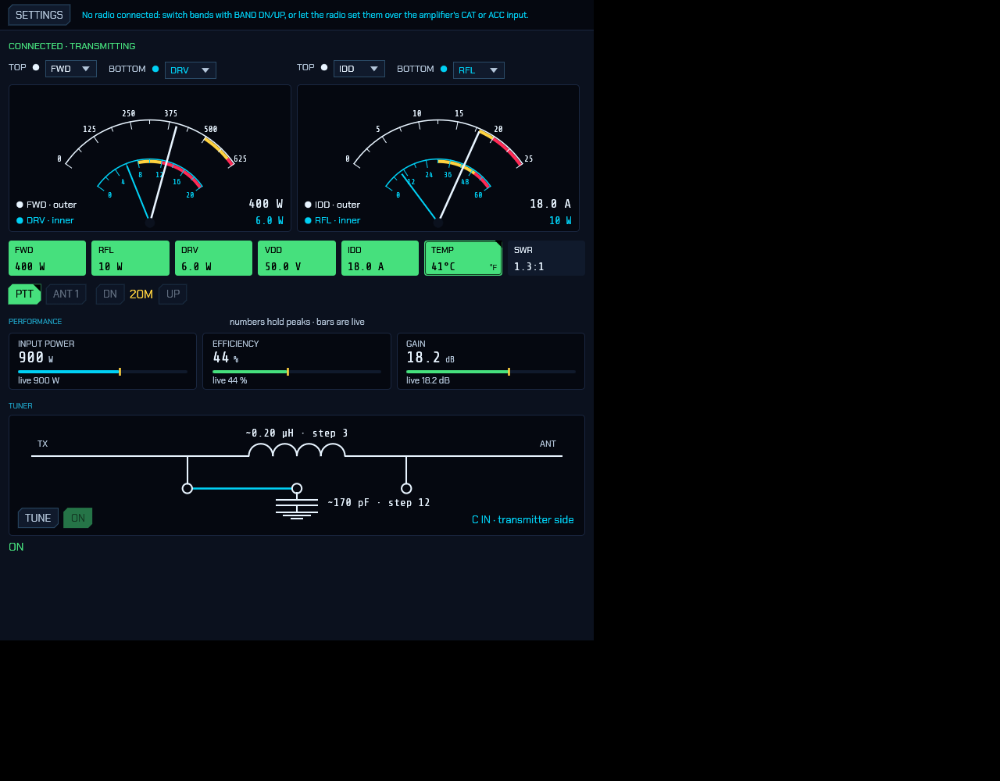
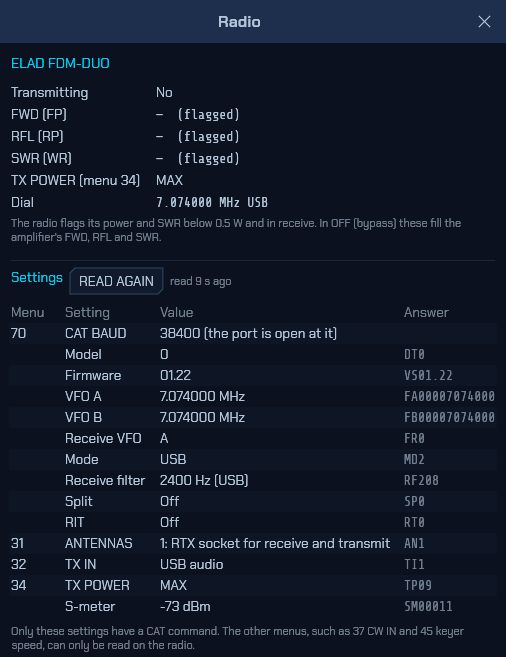

# Hardrock Panel user guide

Hardrock Panel watches and controls a **HobbyPCB Hardrock-500** linear
amplifier over its USB serial port. It shows the amplifier's meters and
readings, works out input power, efficiency and gain while you transmit, and
runs its ATU-500 tuner. The amplifier is still keyed by the radio's PTT line,
as before; the panel never keys it.

It is the AMP window from SDRoxide, running on its own. It needs no radio
program. It can also read an ELAD FDM-DUO's own power, SWR, dial and settings
over the radio's CAT port, set its power, and key its TUNE carrier (see
[The radio](#the-radio)).

> **Tested only with the Hardrock-500.** The Hardrock-50 can be chosen and is
> marked *untested*: it shares the command set, but its limits are scaled
> from the Hardrock-500's and its built-in tuner is shown as raw steps. Watch
> the amplifier's own display until it has been tried on a real one.
>
> Tested on Windows 11 only.

## Setting it up

1. Plug the amplifier's USB lead in and turn the amplifier on.
2. Start `hardrock-panel.exe`. On the first run the **Settings** window opens
   by itself; later, open it with **SETTINGS** at the top left.
3. Tick **Enable**, then choose the **Model** and the **Port** the amplifier
   appears as (COM5, for example). If the port isn't listed, press
   **REFRESH PORTS**.
4. **Baud** must match the amplifier's menu. HobbyPCB's own control panel
   needs 115200, so an amplifier that has been used with it is already there.
5. Press **APPLY**. The status line reads *Connected to the Hardrock-500* when
   the amplifier answers.

**Only one program can have the port open.** Close HobbyPCB's control panel,
and turn off SDRoxide's own amplifier link, before connecting here. If the port
is busy the status line says it is in use by another program, and the panel
connects by itself as soon as that program lets it go: there is no need to
unplug anything.

**SWR warning at** sets where the SWR tile turns red and the meters warn that
FWD and RFL can't be trusted. It starts at 5.0:1, where SDRoxide warns with its
default settings.

The settings, the meter picks, and the window's size and place are kept between
runs.

**From a shortcut.** `hardrock-panel.exe --port COM5` opens straight onto the
amplifier on COM5, ahead of the saved settings. Add `--baud 38400` for another
baud rate. `--radio COM3` (and `--radio-baud 57600`) does the same for the
radio. `--demo` opens the scope on the demo band, `--elad` on the ELAD's I/Q,
`--decode` opens DECODE, and `--size 1200x900` sets the window's size.

## The radio

The panel can read an **ELAD FDM-DUO** over its CAT port, the one SDRoxide or a
logger would use. Besides reading, it changes only the radio's power setting
(menu 34) when you press a power button and its TX IN (menu 32) when you press
USB AUDIO, and keys the radio only when you press TX TUNE or RIG TUNE.

1. In **Settings**, under **Radio**, tick **Enable**, choose the **Port** the
   radio's CAT appears as (COM3, for example), and the **Baud**. It must match
   the radio's menu 70 `CAT BAUD`; the DUO ships at 38400. The port is always
   8N1.
2. Press **APPLY**. The line along the top reads *ELAD FDM-DUO connected*.

As with the amplifier, only one program can have the radio's CAT port open:
close SDRoxide, FDM-SW2 or a logger that uses it first.

**What it gives the panel.** In OFF (bypass), the amplifier reports no FWD,
RFL or SWR. With the radio connected these are the radio's own: its forward
and reflected power (`FP`, `RP`) and its SWR (`WR`), shown while it
transmits. The legends say *from the rig*. Below 0.5 W, in receive, and when
it folds back into a bad load, the DUO flags its readings as not to be
trusted; the panel then shows FWD and RFL as flagged rather than borrowing the
amplifier's DRV, which over-reads into a mismatch. In PTT the amplifier's own
readings are used, and DRV, input power, efficiency and gain are always the
amplifier's.

**The radio window.** **RADIO** along the top opens the radio's own face: its
LCD, with the dial, the annunciators (LP, ATT, ANT, IN, CAT, SPLIT, RIT, the
VFO, XVTR, RX and TX), the S-meter (forward power while transmitting) and the
power setting, RIT offset and level or SWR. Click the top half of a digit to
step it up and the bottom half to step it down, or scroll over it; carries
roll into the next digit, and the dial stays inside the radio's 9 kHz to
54 MHz. With the pointer on the dial the arrow keys pick and step a digit, and
typing a number opens **F INPUT**: MHz below 100 (14.074), kHz from 100 up
(7074), or with a unit. LP, ATT, ANT and IN on the LCD are keys too; IN asks
before it changes where the radio takes transmit audio from.

Under the LCD, **MODE** sets the mode, or a data mode (FT8, FT4, WSPR, RTTY,
PSK31, JS8): USB, its frequency on the band, a filter for its passband and, if
you say yes when asked, TX IN on USB audio. **BAND** goes back to the last
frequency and mode used on each band. **RX**, **CW**, **TX AUDIO** and **MEM**
open the radio's receiver and audio, the keyer with its ten stored messages,
the transmit audio, and memory recall. **MENU** lists every setting the radio
has a CAT command for, grouped, with the ones that can't be changed shown as
read only, and the panel's own display settings: the LCD backlight in receive
and in transmit, and a transverter offset.

Everything shows what the radio reads back, not what was asked for, and greys
while the radio transmits. A stored CW message is sent only when RIG TUNE
could be keyed.

**Transverter.** Set the converter's local oscillator under MENU, Panel
display (116 MHz for a 2 m converter on 28 MHz, negative for one whose LO is
above). The LCD then shows the RF frequency with XVTR lit, F INPUT takes the
RF frequency and sends the radio the IF, and BAND offers the bands the
converter reaches. The radio is never told.

**TUNE.** With the radio connected, a strip under the top line has two ways to
key the radio, its power buttons, the **Tune** slider, and how long TUNE may
run (10 s to start, up to 60 s).

- **1W, 3W, 5W, MAX** set the radio's menu 34 `TX POWER`, as SDRoxide's
  buttons did. It stays set after the panel closes, as on the radio's menu, and
  is the ceiling for every program that transmits. Use MAX with the HR500 in
  line, and bring the power down with the slider.
- **Tune** sets TX TUNE's power within the button's setting: 50% of 5W is about
  2.5 W. The panel shows what it should come to; the meters show what it is.
  It can be moved while keyed.
- **TX TUNE** plays a 1 kHz tone into the radio's USB audio and keys the radio
  as its PTT does, which also keys the amplifier through the PTT line, as
  SDRoxide's TUNE did. It needs the radio's TX IN (menu 32) on USB audio (a
  yellow line with **USB AUDIO** appears if it isn't) and the radio in USB or
  LSB. The tone plays on **TUNE sound** under Settings, Radio: the radio's own
  USB audio unless you choose another.
- **RIG TUNE** keys the radio's own TUNE carrier at the full button setting,
  with no tone. The FDM-DUO may not key its PTT output for it, so the HR500 may
  stay in receive; use TX TUNE to watch the amplifier.

Press either again to unkey. They are greyed, with the reason on hover, unless
the amplifier is connected and not tripped and, in PTT, on the radio's band,
with the power within its 8 W drive limit (so RIG TUNE at MAX, about 8.3 W,
only in OFF, and TX TUNE at MAX up to 96%). They unkey by themselves at the
time limit, on a trip, if the drive goes over the limit, if either SWR reaches
the SWR warning in Settings, if the radio drops to receive on a high SWR, and
if the panel closes or stops responding. The reason is shown after it stops.
These are safety interlocks #5, #6 and #7.

**When the amplifier doesn't key.** If the radio transmits for more than a
moment with the amplifier in PTT and the amplifier's own TX light stays off,
the top line says so in yellow. The HR500 keys only from its PTT input (the RCA
jack, or pin 4 of ACC); check the cable from the radio and the radio's PTT
output setting.

Not to be confused with the tuner's **TUNE**, which starts the ATU-500's
tuning cycle and needs a carrier: TX TUNE or RIG TUNE can provide one.

**RADIO** at the top left opens the radio's window: its dial, large, its live forward and
reflected power, SWR, TX POWER (menu 34) and TX IN (menu 32), the TUNE strip, then
every setting the radio answers over CAT, with its menu number, its meaning and the radio's
answer as it came. **POP OUT** moves it into a window of its own, and
**DOCK** brings it back. The settings are read when the port opens, when you press
**READ AGAIN**, and every 10 seconds between transmissions. Menus that have no
CAT command, such as 37 `CW IN` and 45 keyer speed, can only be read on the
radio.

## Band switching

With the radio connected and **Amplifier follows the radio's band** ticked (it
is, to start), the amplifier's band follows the radio's dial, as in SDRoxide.
It changes only between transmissions: while there is RF in the amplifier the
change waits, and goes out once you unkey. Untick it if the amplifier already
gets its band over its own CAT or ACC cable.

**A radio cabled to the amplifier.** If the radio is also wired to the
amplifier's ACC jack (the FDM-DUO's EXT IO, for example) and the HR500's
**Transceiver** menu names that radio, the amplifier takes its band from the
cable and puts back any other, whatever the panel's setting. The panel can't
change that menu: the amplifier has no command for it. If DN or UP doesn't
hold, the line along the top turns yellow and says so. To control the band
from the panel, set the amplifier's menu to **Transceiver: None** and connect
the radio under SETTINGS; **Amplifier follows the radio's band** then does
what the cable did, and can be turned off.

With no radio connected, nothing tells the panel the radio's frequency, so it
never changes the amplifier's band on its own. Switch bands with **DN** and
**UP**, or let the radio set the band over the amplifier's own CAT or ACC
input. The line along the top of the window says which applies.

## The window

**Its look.** With the FDM-DUO chosen under SETTINGS the window is drawn as
the screen of ELAD's DUO-ART 120 amplifier, to match the radio: the meters
as white dials, a blue status line (mode, band, antenna, where the band
comes from, the tuner), a green diagnostic line, a message line with any
warning on the left and the tuner's state on the right, and the controls as
six soft keys under the screen, each with its label above it. Everything
below is the same in either look; only the drawing changes. Without a
radio the window keeps its own look.

**What can be clicked.** Anything in the window that does something when
clicked shows a pointing hand and a white outline when the mouse is over it.
If the outline appears, it's a control; if it doesn't, it's only a display.
PTT / OFF and the TEMP tile, which would otherwise look like a light and a
reading, also carry a small folded corner at the top right. A button greyed
out by an interlock (see below) shows no outline, because clicking it does
nothing.

**Meters.** Two cross-needle meters, each with a white outer needle and a blue
inner one. Choose what each needle shows with its **TOP** and **BOTTOM**
pickers: forward power, reflected power, drive, supply volts or drain current.
They start as FWD over DRV on the left, so the power meter shows the radio's
drive going in beside the amp's output, and IDD over RFL on the right.
Picking a reading already on the other needle swaps them. The needles are
live; they don't hold peaks. Every scale shows its yellow and red stretches,
and readings that run past the end are marked beyond the arc with their
values, so the limits are always in view.

**When a scale changes range.** The meters start on their full scales: until
power is first seen, the amplifier is taken to be in line and ready to make
full power. Only these change a scale's range, and the legend always says so:

| When | What changes | Legend | Back |
|---|---|---|---|
| The power stays at 10 W or less for 2.5 s while transmitting, in line or in bypass | FWD and DRV to 0–10 W, RFL to 0–2 W | *10 W scale* | To full scale at once when the amp is in line and the power goes over 10 W |
| In OFF (bypass), the power goes over 10 W for 2 s in all, or swings over it twice | FWD and DRV to 0–100 W, RFL to 0–20 W: a 100 W radio running through the bypassed amp | *100 W scale* | Down to the 10 W scale once the power settles at 10 W or less for 2.5 s |
| The power goes over 100 W, or over 10 W with the amp in line | FWD, DRV and RFL to their full scales | (none) | (this is the start) |
| Two needles on one meter would sit on top of each other | The inner (bottom) scale only, to ½, ⅕ or 2× its range, whichever parts them, so both can be read | *rescaled* | Once the needles are well apart on the usual scale |

In OFF (bypass) the radio's own power passes straight through the amp, so the
power counted is the higher of FWD and DRV. Going up to the full scales never
waits, so a needle is never held pinned at real power; coming down waits for
the power to settle. A power range and a rescale can apply at once (*10 W
scale, rescaled*).

**Running barefoot in bypass.** In OFF the DRV tile stays green whatever it
reads, tuner in or not, because the radio's power passing straight through is
not a fault. **PTT** is greyed while the drive is over the amplifier's drive
limit (8 W on the HR500): hover over it to see why, and lower the radio's
power before putting the amplifier in line.

In OFF the amplifier reports no forward or reflected power and no SWR. With
the radio connected they are the radio's own (see [The radio](#the-radio)).
With no radio to ask, **FWD** shows the amplifier's DRV reading, which measures the
radio's power at the amplifier's input; in bypass that power goes straight
through. The legend says *from DRV*. DRV over-reads into a mismatch, so treat
it as a guide. RFL and SWR stay empty in bypass. In PTT the amplifier's own
readings are always used.

**Readings.** Seven tiles: FWD, RFL, DRV, VDD, IDD, TEMP and SWR. Each takes
the amplifier's own colour for that reading: green, yellow or red. A colour
the amplifier holds after a transmission (it latches red until the next
key-up) is held here too, with one exception. Until your first transmission
after the panel connects, a yellow from the amplifier shows green. The HR500
can start up with DRV yellow, or still hold a yellow from an earlier session,
with nothing wrong now. A red (a trip) always shows. From your first key-up the
tiles follow the amplifier's lights exactly, so its own screen and this one can
differ only before then. SWR has no colour of its own, as on the amplifier,
except that it turns **red** at or past the SWR warning set in Settings. Click
**TEMP** to switch between °C and °F; it switches the amplifier's own display
as well.

**Controls.**

- **PTT / OFF** puts the amplifier in line (green) or in bypass (blue).
- **ANT** chooses the antenna jack.
- **DN / UP** step the band.

**Performance.** Input power (volts × amps), efficiency (output over input) and
gain (output over drive, in dB), worked out only while transmitting. The
number holds its peak for a second and then falls away; the bar under it is
live, with the held peak marked on it. This suits FT8 and SSB, where the
readings move too fast to read.

**Tuner.** A drawing of the ATU-500's network: the inductor and capacitor it
has switched in, with values, and which side the capacitor is on. When the
tuner is bypassed, the drawing shows the bypass relays instead.

- **TUNE** starts a tune. It blinks blue while tuning, turns green when tuned
  and red if the tune fails, with the result and SWR on the line below.
- **ON / BYP** puts the tuner in line or bypasses it.

The tuner only reports step numbers. The values shown (for example "~0.20 µH ·
step 3") are an estimate that includes the board's own stray inductance and
capacitance, judged good to about 10%. How the values were arrived at is in
[atu-values.md](atu-values.md).

**Resizing.** Drag the window to any size: the panel scales to fit its width
and height and sits centred in it.

## The scope and the panel's receiver

**SCOPE**, on the top bar beside RADIO, opens the panadapter: the spectrum (or
the 3D FFT), the band plan and the waterfall from the radio's I/Q, with the
panel's own receiver in it. **POP OUT** puts it in a window of its own; **DOCK**
brings it back over the panel.

**Where the I/Q comes from** is chosen under SETTINGS, *Scope and receiver*,
with APPLY:

- **ELAD over USB**: the FDM-DUO's second USB lead (the I/Q device). On
  Windows that device must be on the **WinUSB** driver, set with Zadig; ELAD's
  own FDM-SW2 can't see it until its driver is put back. If it won't open, the
  scope's I/Q line says why in the driver's words, with **TRY AGAIN**. The
  panel waits a few seconds for the CAT link to read VFO A and opens the I/Q
  there, so opening doesn't move the radio.
- **Demo signals**: a made-up band around 14.2 MHz with a few stations and
  noise, to try the scope and DECODE with no radio.

**Tuning.** As in SDR Console, the span stays centred on the DUO's VFO A
while the panel's receiver moves inside it. Click a signal to tune to it, drag
the receiver marker, drag a filter edge to set the width, wheel to step,
ctrl+wheel to zoom, drag to pan, double-click for the whole span. When the
receiver nears the edge, the panel moves VFO A (over CAT) and the span
follows. Turning the radio's own knob moves the span, and the receiver with
it. **SPAN** changes the I/Q rate (192 kHz to 6.144 MHz; on the DUO set the
same rate on the radio).

**Listening.** The receiver plays on the sound output chosen under SETTINGS,
*Receiver sound*: the computer's default output to start, or any other by
name, VB-Cable's *CABLE Input* included, to feed an outside decoder. The
scope has its volume and **Mute**. Up to 192 kHz the DUO plays its own audio
too, and the panel sets the DUO's mode and filter to the receiver's; above
192 kHz the DUO mutes its own audio and the panel's receiver is the one heard.

**TX follows RX** (on to start) makes the radio transmit where you listen:
while the receiver is off VFO A, the panel puts the radio in split with VFO B
on the receiver, and takes split off again when the receiver is back on VFO A.
It needs both the CAT link and the ELAD's I/Q. Turn it off to leave split to
you; a split the panel made is taken off.

**While transmitting** the scope tunes nothing: clicks, drags, the wheel, the
band plan and the data-mode keys are locked, VFO A and B and split are left
alone, and the top bar says so. Zoom, markers and the display still work.

**Transverter.** The radio window's transverter offset and the scope's
*Transverter LO* are the same setting: change either and the other follows.

## Decoding

**DECODE**, on the top bar, opens the panel's own decoders. Pick a mode and
press **RUN**; it keeps decoding with the window closed until **STOP**.

- **WSJT**: FT8, FT4, WSPR, JT65, JT9, FST4-60 and Q65-30A, from the
  receiver's audio in UTC slots. Each decode shows its UTC, SNR, DT (a
  drifting PC clock shows here), audio frequency and RF frequency. Put the
  receiver on the mode's dial frequency (the scope's **Data** keys do it) in
  USB.
- **Keyboard**: RTTY (45.45 baud, 170 Hz), PSK31, NAVTEX, Olivia 8/500 and
  THOR16, as running text. Set the audio frequency the signal sits at.
- **Pictures**: SSTV (its mode from the picture's header) and WEFAX (choose
  the LPM; it starts and stops on the tones, or with **Start now** and
  **Stop**).
- **From I/Q**: HFDL, VHF ACARS, VDL2, AIS and Mode S, from the I/Q rather
  than the receiver, every channel in the span at once. Behind a converter,
  set its LO as the transverter offset and they report the true RF. Mode S
  needs the DUO's 3.072 or 6.144 MHz rate.

The line above the list says how many blocks of audio or I/Q the decoder had
to drop because it fell behind; it should stay at 0.

## Outside programs

Under SETTINGS, *Outside programs*, all off to start and taken with APPLY:

- **TCI server** (port 50001): for WSJT-X (rig *TCI Client*), JTDX, MSHV and
  skimmers. They see the panel's receiver as the radio and can tune it,
  change its mode and take its audio and, up to 384 kHz, its I/Q.
- **rigctld server** (port 4532): Hamlib's *NET rigctl* (rig 2) for WSJT-X,
  fldigi, JS8Call and loggers, with no serial cable.
- **WSJT-X UDP decodes** (127.0.0.1, port 2237): the panel's own FT8, FT4 and
  WSPR decodes, for GridTracker, JTAlert and loggers.
- **Allow outside programs to transmit** (off): with it off, programs see a
  receive-only radio. With it on, a program may ask to transmit, and the panel
  keys the radio only when its TUNE checks pass: the amplifier connected, not
  tripped and on the radio's band, and the radio's power setting (menu 34)
  under the amplifier's drive limit while it is in line; and for audio, TX IN
  on USB audio and the radio in USB or LSB. The program's audio goes to the
  radio's USB audio sound card as usual. The panel unkeys when the program
  lets go or disconnects, on any of TUNE's stop conditions (a trip, high SWR,
  overdrive), after a minute at most, when you press STOP on the TUNE strip,
  or when you untick the setting. The top bar says when a program has the
  radio keyed.

## What the panel won't do while you transmit

Switching a relay with RF on it can damage it, and on the Hardrock it makes the
amplifier flag reflected power. So while there is RF in the amplifier, the
panel won't switch the antenna, band or tuner:

- **ANT**, **DN**, **UP** and **ON / BYP** are greyed out, and hovering over
  them says why. Unkey first.
- The amplifier is asked whether it is transmitting before any of those is
  sent, and the command is dropped if it is, or if it doesn't answer.
- **PTT** can't be switched on (OFF to PTT) while the drive is over the
  amplifier's drive limit, 8 W on the HR500, as with a 100 W radio running
  barefoot through the bypassed amp. Lower the drive first.

- The amplifier's band is not changed to follow the radio until the
  transmission ends.
- The scope, and outside programs, don't retune the receiver or the radio,
  and the panel doesn't change split, until the transmission ends.
- The ELAD's I/Q isn't opened, and its centre isn't moved over USB, until the
  transmission ends.
- An outside program can't key the radio unless TUNE could be keyed at the
  radio's full power setting.

Each of these is marked *SAFETY INTERLOCK* in the code and explained in
[safety-interlocks.md](safety-interlocks.md).

## Trips and over-temperature

When the amplifier trips, the status line at the top of the window turns red
and says *TRIPPED*, naming the reading that tripped it. Above its temperature
limit it reads *OFF LINE · over temperature*. The amplifier does the
protecting; the panel only reports it.
